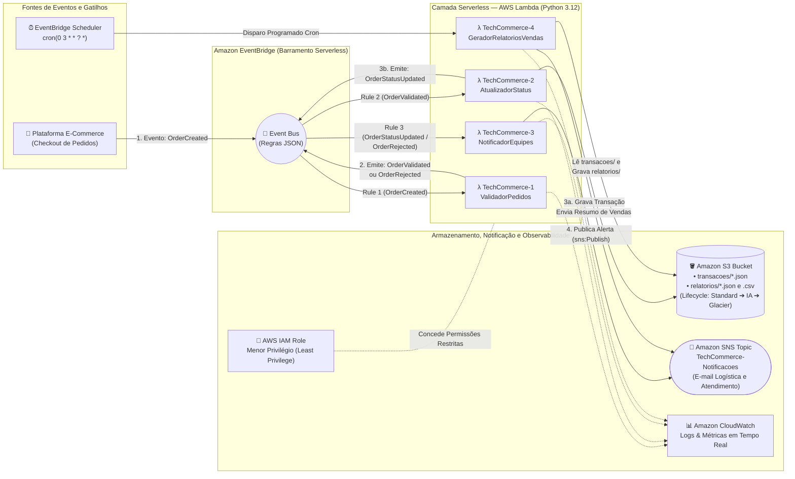
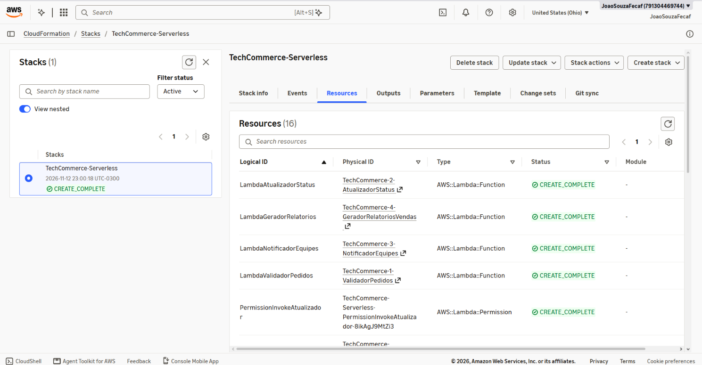
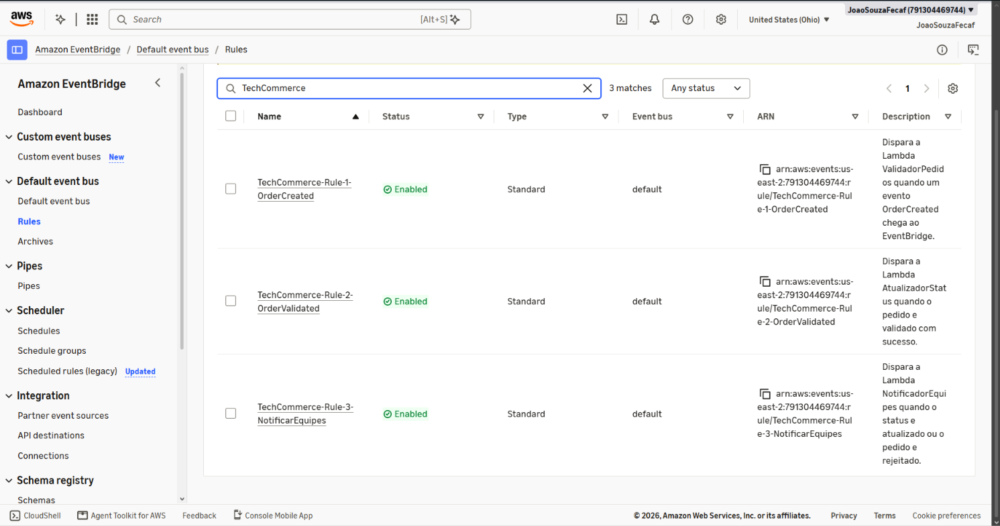
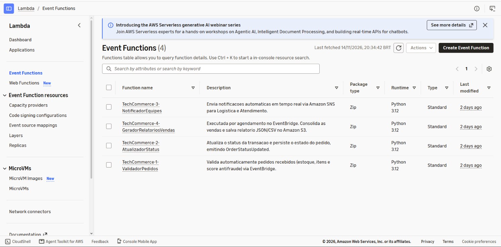
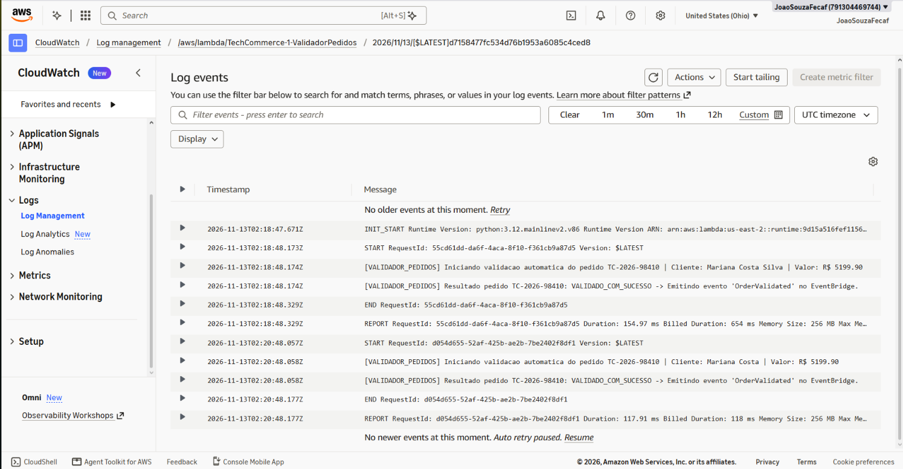
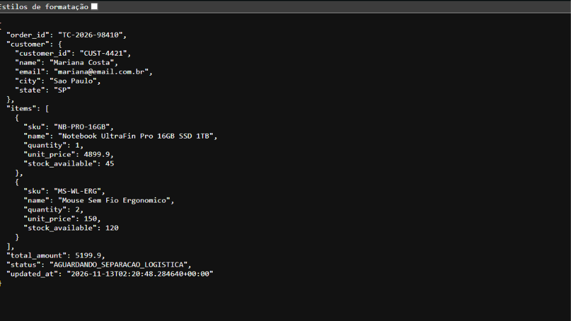
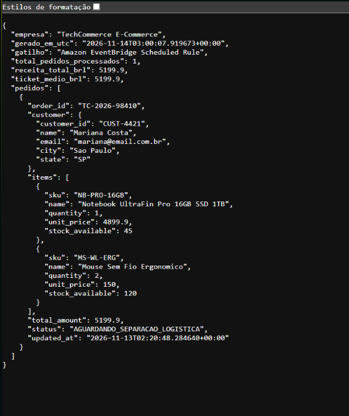
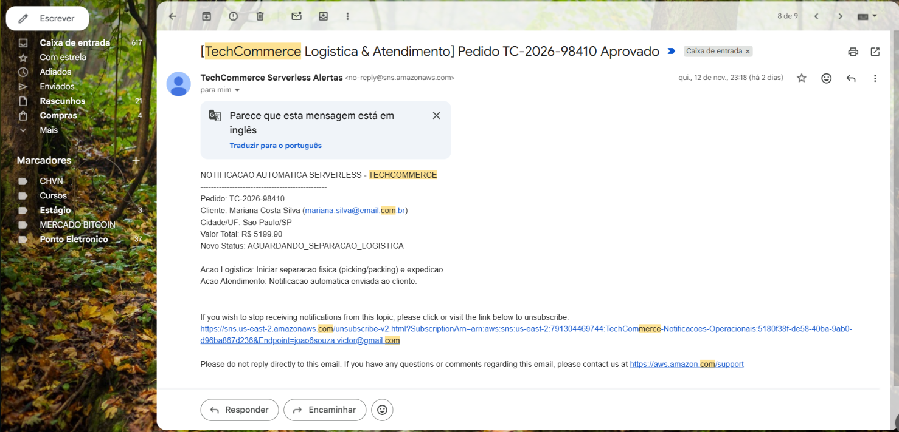
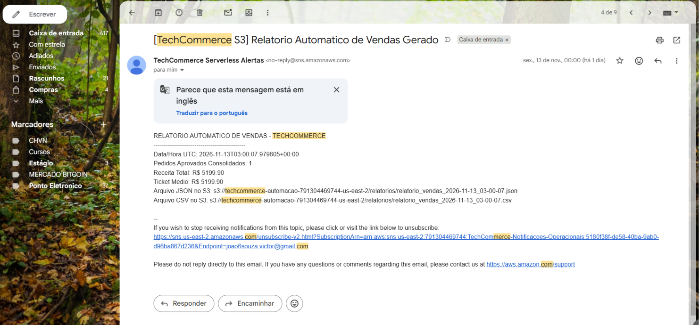

# ☁️ TechCommerce Serverless — Event-Driven Architecture na AWS


Arquitetura **100% Serverless e Orientada a Eventos (EDA)** projetada e implantada na **Amazon Web Services (AWS)** para automatizar o processamento de pedidos, análise antifraude/estoque, notificações operacionais em tempo real e geração agendada de relatórios de vendas na plataforma de e-commerce **TechCommerce**.

> 🎥 **[Assista à Demonstração em Tempo Real no Console da AWS (YouTube — 4 min)](https://www.youtube.com/watch?v=ptYKxoZtsGo)**

---

## 📌 Visão Geral e Problema Resolvido

Em operações de e-commerce com fortes picos sazonais (*Black Friday*, Natal e promoções relâmpago), arquiteturas tradicionais acopladas e baseadas em servidores dedicados sofrem com:
1. **Gargalos de escalabilidade** durante picos repentinos de pedidos;
2. **Custos fixos elevados** mantendo máquinas ociosas 24/7 fora do horário de pico;
3. **Atrasos e falhas humanas** na validação de pedidos, comunicação entre equipes de Logística/Atendimento e consolidação diária de relatórios financeiros.

Esta solução substitui servidores dedicados por **4 funções AWS Lambda independentes (`Python 3.12`)**, orquestradas por **4 regras no Amazon EventBridge** (3 reativas a eventos de domínio em tempo real e 1 programada via expressão `cron`), integradas ao **Amazon S3**, **Amazon SNS**, **AWS IAM** e **Amazon CloudWatch**.

---

## 🏗️ Arquitetura da Solução na AWS



---

## 🔄 Fluxograma de Automação (Tempo Real + Batch Agendado)

```mermaid
flowchart TD
    subgraph FluxoA["FLUXO A — Automação Orientada a Eventos da Aplicação (Tempo Real)"]
        A1([Cliente finaliza pedido no E-Commerce]) --> A2["Publica evento JSON no Amazon EventBridge<br/>source: com.techcommerce.orders<br/>detail-type: OrderCreated"]
        A2 --> A3["Regra 1 (TechCommerce-Rule-1-OrderCreated)<br/>aciona λ TechCommerce-1-ValidadorPedidos"]
        A3 --> A4{"Itens válidos, Estoque OK<br/>e Score Antifraude <= 80?"}

        A4 -- "SIM (Aprovado)" --> A5["Publica evento no EventBridge:<br/>detail-type: OrderValidated"]
        A5 --> A6["Regra 2 (TechCommerce-Rule-2-OrderValidated)<br/>aciona λ TechCommerce-2-AtualizadorStatus"]
        A6 --> A7["Persiste transação atualizada no Amazon S3<br/>(transacoes/order_id.json)<br/>Status: AGUARDANDO_SEPARACAO_LOGISTICA"]
        A7 --> A8["Publica evento no EventBridge:<br/>detail-type: OrderStatusUpdated"]

        A4 -- "NÃO (Rejeitado)" --> A9["Publica evento no EventBridge:<br/>detail-type: OrderRejected"]

        A8 --> A10["Regra 3 (TechCommerce-Rule-3-NotificarEquipes)<br/>aciona λ TechCommerce-3-NotificadorEquipes"]
        A9 --> A10
        A10 --> A11(["Publica alerta no Amazon SNS (sns:Publish)<br/>Envia e-mail em tempo real para Logística e Atendimento"])
    end

    subgraph FluxoB["FLUXO B — Automação Baseada em Agendamento Programado (Batch Serverless)"]
        B1(["Gatilho Temporal no EventBridge<br/>Regra 4: cron(0 3 * * ? *)"]) --> B2["Aciona automaticamente<br/>λ TechCommerce-4-GeradorRelatoriosVendas"]
        B2 --> B3["Lista e lê os arquivos de transações<br/>no Bucket Amazon S3 (transacoes/*.json)"]
        B3 --> B4["Calcula indicadores consolidados:<br/>Total de Pedidos, Receita Bruta e Ticket Médio"]
        B4 --> B5["Grava relatórios consolidados no Amazon S3:<br/>• relatorios/relatorio_vendas_data.json<br/>• relatorios/relatorio_vendas_data.csv"]
        B5 --> B6(["Publica resumo executivo no Amazon SNS<br/>Notificando conclusão do relatório por e-mail"])
    end
```



---

## ⚙️ Catálogo de Regras no Amazon EventBridge e Microsserviços Lambda

| Regra no EventBridge | Tipo de Gatilho | Padrão / Expressão | Função AWS Lambda Acionada | Responsabilidade |
| :--- | :--- | :--- | :--- | :--- |
| `TechCommerce-Rule-1-OrderCreated` | Evento de Domínio | `source: com.techcommerce.orders`<br/>`detail-type: OrderCreated` | `TechCommerce-1-ValidadorPedidos` | Valida itens, disponibilidade de estoque por SKU e `fraud_risk_score <= 80`. Emite `OrderValidated` ou `OrderRejected`. |
| `TechCommerce-Rule-2-OrderValidated` | Evento de Domínio | `source: com.techcommerce.orders`<br/>`detail-type: OrderValidated` | `TechCommerce-2-AtualizadorStatus` | Atualiza status para `AGUARDANDO_SEPARACAO_LOGISTICA`, persiste em `transacoes/<order_id>.json` no S3 e emite `OrderStatusUpdated`. |
| `TechCommerce-Rule-3-NotificarEquipes` | Evento de Domínio | `source: com.techcommerce.orders`<br/>`detail-type: OrderStatusUpdated, OrderRejected` | `TechCommerce-3-NotificadorEquipes` | Publica alertas operacionais e antifraude no tópico **Amazon SNS**, notificando Logística e Atendimento por e-mail. |
| `TechCommerce-Rule-4-RelatorioAgendadoCron` | Agendamento (`Cron`) | `cron(0 3 * * ? *)`<br/>*(Diariamente às 03:00 UTC / 00:00 BRT)* | `TechCommerce-4-GeradorRelatoriosVendas` | Consolida transações do S3, calcula receita total e ticket médio, gera relatórios `.json` e `.csv` em `relatorios/` no S3 e envia resumo via SNS. |

---

## 📸 Evidências Reais de Implantação e Execução na AWS (`us-east-2`)

### 1. Infraestrutura como Código (AWS CloudFormation — 16 Recursos Provisionados)


### 2. Regras Orientadas a Eventos no Amazon EventBridge e Funções no AWS Lambda
| Regras no Amazon EventBridge | Funções AWS Lambda (`Python 3.12`) |
| :---: | :---: |
|  |  |

### 3. Logs de Execução no Amazon CloudWatch (`~117 ms` de Duração)


### 4. Persistência de Transações e Relatórios Agendados no Amazon S3
| Transação Validada (`transacoes/TC-2026-98410.json`) | Relatório Consolidado via Cron às `03:00:07 UTC` (`relatorios/`) |
| :---: | :---: |
|  |  |

### 5. Notificações em Tempo Real Recebidas via Amazon SNS
| Alerta de Pedido Aprovado (Logística & Atendimento) | Resumo Automático do Relatório de Vendas |
| :---: | :---: |
|  |  |

---

## 📂 Estrutura do Repositório

```text
projeto-techcommerce/
├── template-cloudformation-aws.yaml   # Template IaC AWS CloudFormation (Deploy em 1 clique na AWS)
├── serverless.yml                     # Configuração IaC para Serverless Framework
├── simular_execucao.py                # Simulador local do barramento de eventos e funções Lambda
├── src/
│   └── handler.py                     # Código-fonte modular das 4 funções Lambda (Python 3.12)
├── events/
│   ├── evento_pedido_criado.json      # Payload de exemplo para disparo no EventBridge (OrderCreated)
│   └── evento_agendamento_cron.json   # Payload de evento agendado (Scheduled Event)
├── output/                            # Artefatos gerados pela simulação local (JSON, CSV e Logs)
└── docs/
    └── screenshots/                   # Prints reais da execução na AWS (us-east-2)
```

---

## 🚀 Como Executar o Projeto

### Opção A: Implantação Real na AWS via CloudFormation (100% Free Tier)
1. Acesse o Console do **AWS CloudFormation** $\rightarrow$ **Create stack** $\rightarrow$ **With new resources (standard)**.
2. Escolha **Upload a template file** e envie o arquivo [`template-cloudformation-aws.yaml`](template-cloudformation-aws.yaml).
3. Informe o nome da stack (`TechCommerce-Serverless`) e seu e-mail no parâmetro `EmailNotificacao`.
4. Confirme a assinatura recebida no seu e-mail pelo **Amazon SNS**.
5. No console do **Amazon EventBridge** $\rightarrow$ **Event buses** $\rightarrow$ **Send events**, envie um evento com:
   - **Event source**: `com.techcommerce.orders`
   - **Detail type**: `OrderCreated`
   - **Event detail**: copie o objeto interno do pedido em [`events/evento_pedido_criado.json`](events/evento_pedido_criado.json).

### Opção B: Simulação Local (Sem necessidade de conta AWS)
Basta ter o **Python 3.10+** instalado (não requer bibliotecas externas):

```bash
python simular_execucao.py
```
Os logs detalhados no formato CloudWatch e os relatórios `.json` e `.csv` serão gerados automaticamente no diretório `output/`.
